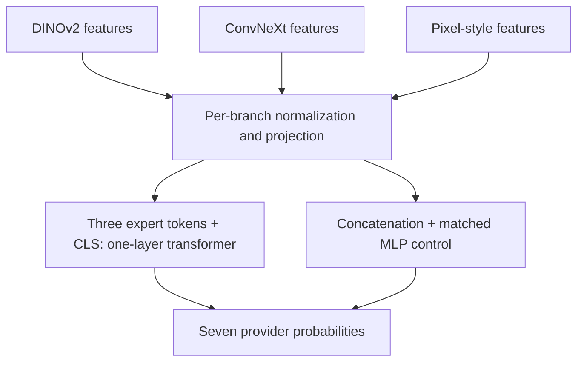

# Fusion and Jev-style decision experiments — 17 October 2026

## Outcome

**Keep the existing equal DINOv2 + ConvNeXt ensemble as the recommended submission.** The requested three-expert transformer was implemented, trained and tested, but it did not improve the reused development holdout. A matched MLP came closer and is included as an experimental backup. An open decision model, Julia-1, was also tested after the clarification that “Jev” meant decision models; its fixed zero-shot configuration performed poorly.

These are measured local development results. No new Kaggle submission was made, no hidden test labels were available, and no Kaggle improvement is claimed. The proprietary Jev service was not evaluated: no Jev API credential was configured, so the actual decision-model test used the independently published open Julia-1 model.

## Measured comparison

All models were evaluated on the same 1,976 labelled development images. The reference uses the earlier selected DINOv2 and ConvNeXt models, averaging their seven class probabilities equally.

| Candidate | Correct / 1,976 | Accuracy | Fixes relative to reference | New errors relative to reference |
|---|---:|---:|---:|---:|
| Existing DINOv2 + ConvNeXt average | **1,919** | **97.12%** | 0 | 0 |
| Tuned encoder features + MLP | 1,917 | 97.01% | 11 | 13 |
| Tuned encoder features + transformer | 1,904 | 96.36% | 10 | 25 |
| Public pretrained encoder features + MLP | 1,895 | 95.90% | 18 | 42 |
| Public pretrained encoder features + transformer | 1,892 | 95.75% | 14 | 41 |
| Julia-1 only when DINOv2 and ConvNeXt disagree | 1,857 | 93.98% | 3 | 65 |
| Julia-1 makes every final choice | 131 | 6.63% | 4 | 1,792 |

The best new MLP is two images behind the reference, a difference of about 0.10 percentage points. That is a small observed difference and does not establish statistical or future Kaggle superiority for either model. It provides no evidence to replace the reference. The requested tuned-feature transformer is 15 images behind, about 0.76 percentage points.

The predeclared practical requirement for accepting a more complex replacement was at least 1,927/1,976: eight more correct predictions than the reference. No candidate met that threshold, or even exceeded the raw reference score. This was a complexity decision rule, not a statistical significance test.

Additional metrics support retaining the reference in this run:

| Candidate | Macro F1 | Log loss | Multiclass Brier score | ECE, 15 equal-width bins |
|---|---:|---:|---:|---:|
| Existing ensemble | 0.96960 | 0.13762 | 0.05099 | 0.01641 |
| Tuned features + MLP | 0.96744 | 0.15139 | 0.05277 | 0.02465 |
| Tuned features + transformer | 0.95953 | 0.20313 | 0.06455 | 0.02682 |
| Julia disagreement hybrid | 0.93586 | 0.25167 | 0.08769 | 0.02869 |
| Julia alone | 0.02783 | 4.27262 | 1.44882 | 0.65625 |

Brier scores sum the squared errors across all seven classes before averaging examples. Full metrics, confusion matrices, per-class reports and per-image probabilities are included in the core archive's `results/` directory.

## Three-expert architecture

The inputs are three complementary fixed views of the same image:

1. DINOv2 ViT-S/14: 768 values from its CLS token and mean patch features.
2. ConvNeXt-Tiny: 768 pooled feature values.
3. Pixel style: 1,460 values describing color, alpha/transparency, grids, edges and local texture.

The third input is a deterministic feature branch, not a third large pretrained neural network. It was chosen to add provider-style information while keeping the experiment small and explainable. All image processing preserves the provider classification task; IDs, filenames and metadata are not used as predictive features.

The transformer has four attention heads, width 64, feedforward width 128 and 226,631 trainable parameters. The MLP uses the same projected features, a hidden width of 160 and 224,839 trainable parameters. Both were trained with the same optimizer, schedule, data partitions and fixed seed set.

This is a TRIBE-v2-inspired adaptation of feature fusion to emoji classification. It does not reproduce TRIBE v2's full model or original task. A fusion layer is a learned classifier; it does not become an infallible source of truth because it attends to several experts.

## Training and selection

There were two feature conditions: original public pretrained encoders, and the earlier task-fine-tuned encoders. Encoders were frozen throughout the new fusion runs. Head standardization was fitted only on the applicable head-training partition, with a standard-deviation floor and clipping at ±8.

The original 7,903 training images were split internally into 6,322 training and 1,581 validation examples, using the first fold of five-fold StratifiedGroupKFold with seed 271828. Groups join exact image matches under both the 96-pixel and actual 224-pixel RGB representations. The recorded inner and outer partitions have no overlap between these exact duplicate groups. This addresses exact duplicates; it does not claim that all semantically related emoji designs are independent.

For seeds 17, 43 and 101, epochs were selected internally using accuracy and then log loss. Models were refitted on the original 7,903 images for those selected epochs. The three seed probability arrays were averaged equally. There was no selection of a best seed using outer scores.

| Candidate | Selected epochs for seeds 17 / 43 / 101 | Outer correct counts for individual seeds |
|---|---|---|
| Public pretrained features + MLP | 8 / 29 / 14 | 1,875 / 1,889 / 1,895 |
| Public pretrained features + transformer | 12 / 5 / 7 | 1,873 / 1,870 / 1,870 |
| Tuned features + MLP | 36 / 6 / 38 | 1,915 / 1,915 / 1,918 |
| Tuned features + transformer | 12 / 14 / 17 | 1,906 / 1,896 / 1,904 |

All recipes and internal choices were locked before central outer evaluation. Internal validation favored the MLP in the public-pretrained condition, and the transformer in the tuned condition. The latter inner result should not be treated as independent evidence: those tuned encoders had previously trained on all 7,903 examples, including the head's inner validation examples.

## What the Jev-style test actually did

TypeSafe describes Jev as a decision model that consumes structured state and a typed question and returns a decision. The open model used here, **SupersonicLabs/Julia-1**, is a separate 144.3-million-parameter model built on a ModernBERT/mmBERT-small encoder with a decision head. Its source and model card are linked below; the archived revision is `a85b127321d580d65176c89ced8273f305745d85`.

Julia received a fixed seven-option provider question and the 21 probabilities from the DINOv2, ConvNeXt and style classifier, rounded to four decimals. The input state contained no image pixels, IDs, filenames or ground-truth labels. It was a frozen, zero-shot decision layer: there was no emoji fine-tuning, prompt search or calibration using validation labels.

Two recipes were fixed in advance:

- Julia selects the provider for every image.
- Julia is used only when the two neural models disagree on their top class; otherwise retain the equal neural ensemble.

The first made 131 correct choices out of 1,976. The hybrid routed 112 development images to Julia and scored 1,857/1,976. It fixed three reference errors but introduced 65 new errors. The hybrid's test CSV was generated by applying the same rule to 574 test disagreements and preserving the original ensemble probabilities on the other 9,305 images. It is included as an explicitly unsuccessful experimental output. A full Julia-only test pass was not run after the poor development result.

The full validation inference took about 495 seconds on two CPU threads; the 574 routed test decisions took about 138 seconds. These timings measure this execution environment, not Jev service latency or Julia performance on other hardware.

### Diagnostic check of Julia's low accuracy

Nine existing validation requests spanning all seven predicted classes were replayed using the upstream engine's own `predict` method. The engine's choice, raw-logit argmax and exported argmax agreed. Decoding the option markers confirmed the exact provider order. There were 1,965 distinct logit rows across the full validation set, so this was not a constant-output run.

The configuration was strongly biased toward Google and Messenger: it selected them for 1,867/1,976 images, about 94.48%. Rebatching produced tiny logit differences, at most 0.0000163, without changing the audited choices. The checks found no label-order or exported-argmax error; they do not establish the underlying cause of the bias.

The defensible conclusion is narrow: this fixed numeric-state, zero-shot Julia setup was unsuccessful. The result does not measure proprietary Jev, and does not establish that decision models cannot work after appropriate domain training or with a different input formulation.

## Reproducibility and practical limits

Independent verification joined original IDs and labels, rebuilt the reference ensemble, and reproduced every fusion family's labelled and test probability averages bit-for-bit from its three seeds. All four fusion submission files contain exactly the expected 9,879 unique test IDs and valid provider labels. A fresh raw-image replay on 12 images also reproduced every saved feature vector, each seed prediction and the final tuned-transformer probabilities exactly.

The reused outer holdout already influenced previous encoder checkpoint and ensemble choices. It is therefore a development benchmark, not an untouched test set. No outer labels were used to train the new fusion heads or modify Julia's fixed prompt after scoring, but the overall workflow still has this selection history. Higher or lower scores here do not guarantee a corresponding Kaggle change.

The practical recommendation is to keep the existing ensemble for the next intended submission and retain the tuned MLP as the closest new backup. The transformer and Julia runs supply useful negative experimental evidence for an architecture comparison. They should not consume scarce Kaggle uploads merely because they are newer or more complex.

## Deliverables and transparency

The core fusion archive contains all four fusion CSVs, the existing recommended CSV, fitted checkpoints, original model provenance, requirements, source code, reproduction commands, logs and evaluation records. A separate optional cached-feature ZIP supports fast replay and head retraining; extracting it beside the main ZIP merges the required files into the same bundle directory. The separate decision-model archive contains the Julia tokenizer, upstream code and licenses, exact requests, probabilities, diagnostic records, an experimental hybrid CSV and the small expert inputs needed to replay the decision layer. Its downloader retrieves the exact publicly available Julia weight revision and verifies the original byte size and SHA256 before use, keeping the download package small.

The code, experiment orchestration, checks, this note and reproduction documentation were AI-assisted. `AI_USAGE.json` records the visible prompts and contributions. The mistaken JEPA branch was canceled after the user's correction and is not presented as a completed experiment. The students should write their own course report and disclose how these materials were produced.

## Primary sources

- TRIBE v2 official repository: https://github.com/facebookresearch/tribev2
- TRIBE v2 paper: https://arxiv.org/html/2605.04326v1
- TypeSafe Jev documentation: https://docs.typesafe.ai/introduction
- Julia-1 model card and upstream implementation: https://huggingface.co/SupersonicLabs/Julia-1

All numerical experiment results above come from the actual saved local predictions and verification records in these archives, not from claims in the linked model cards.
